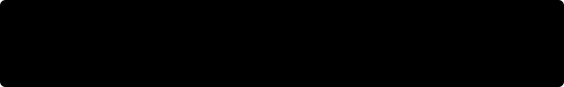

[soumik-portfolio](https://github.com/Hack-master22/soumik-portfolio) &nbsp;·&nbsp;
[linkedin](https://www.linkedin.com/in/soumikdey/) &nbsp;·&nbsp;
[email](mailto:soumikdey666@gmail.com)

> Soumik Dey. Developer, builder, speaker. 
> Ship fast, learn faster, break nothing that matters.

I build web apps and tools that solve real problems. Currently deep into 
frontend craft — JavaScript, CSS, responsive design — and always looking 
for the next thing to ship.

<samp>javascript &nbsp; css &nbsp; html &nbsp; react &nbsp; node &nbsp; python &nbsp; git &nbsp; github &nbsp; vscode</samp>

**[soumik-portfolio](https://github.com/Hack-master22/soumik-portfolio)** &nbsp;·&nbsp; <samp>javascript</samp> 
Personal portfolio site — the live version of everything I build and believe in.

**[My-portfolio](https://github.com/Hack-master22/My-portfolio)** &nbsp;·&nbsp; <samp>css, html</samp> 
Earlier portfolio iteration. Clean layout, pure CSS, no frameworks.

**[To-do-list](https://github.com/Hack-master22/To-do-list)** &nbsp;·&nbsp; <samp>javascript</samp> 
Minimal task manager — DOM manipulation, local storage, zero dependencies.

Open to collaborations, hackathons, and interesting conversations. 
Reach me at [soumikdey666@gmail.com](mailto:soumikdey666@gmail.com) or connect on [LinkedIn](https://www.linkedin.com/in/soumikdey/).
