[linkedin](https://www.linkedin.com/in/soumik-dey-30496a202/) &nbsp;·&nbsp;
[email](mailto:soumikdey666@gmail.com)

> Soumik Dey. SDE &amp; AI Engineer, Kolkata. 
> Small, sharp tools over big vague ideas.

I build multi-agent AI systems and full-stack platforms that solve hard 
problems. Right now that's [Swasthya-Setu-Ai](https://github.com/Soumik-Dev-Ai/Swasthya-Setu-Ai), a rural clinical triage 
platform that runs offline for ASHA workers, and [sentinel-ai](https://github.com/Soumik-Dev-Ai/sentinel-ai), an autonomous 
code-generation agent that tests and self-corrects its own code.

<samp>typescript &nbsp; python &nbsp; javascript &nbsp; c++ &nbsp; react 19 &nbsp; next.js 16 &nbsp; fastapi &nbsp; node &nbsp; postgres &nbsp; supabase &nbsp; redis &nbsp; tailwind &nbsp; three.js &nbsp; faiss &nbsp; docker &nbsp; git</samp>

**[Swasthya-Setu-Ai](https://github.com/Soumik-Dev-Ai/Swasthya-Setu-Ai)** &nbsp;·&nbsp; <samp>react 19, fastapi, pgvector, sqlalchemy, tailwind</samp> 
Rural clinical triage platform. WHO ETAT emergency red-flags in &lt;1s, hybrid 
RAG over IMCI/IPHS guidelines, PM-JAY cost lookup, offline-first IndexedDB 
queueing for ASHA field workers. 220 unit tests, Neon Serverless Postgres.

**[sentinel-ai](https://github.com/Soumik-Dev-Ai/sentinel-ai)** &nbsp;·&nbsp; <samp>python, fastapi, react 19, faiss, openai/anthropic/gemini</samp> 
Autonomous self-correcting multi-agent coding platform. Tree-of-Thought 
planning, LLM-as-a-Judge auditing, sandboxed polyglot execution (Python, 
Go, Rust, C, C++, JS), FAISS RAG memory, and adaptive retry routing.

**[Hospital-Booking-System](https://github.com/Soumik-Dev-Ai/Hospital-Booking-System)** &nbsp;·&nbsp; <samp>next.js 16, react 19, fastapi, supabase, redis, drizzle</samp> 
Alder &amp; Sage — 4-portal autonomous concierge medical clinic. Multi-LLM 
triage with prompt-injection firewall (OpenRouter → Groq → Cerebras), 
cron enforcement engine, Gmail/Google Sheets/Calendly sync, arq queue.

**[linkedin-triage](https://github.com/Soumik-Dev-Ai/linkedin-triage)** &nbsp;·&nbsp; <samp>next.js 16, react 19, three.js, framer-motion</samp> 
AI outreach &amp; candidate filtering SaaS. Multi-LLM neural cascade routing 
simple tasks to Llama 3.1 8B via Groq and complex reasoning to Gemini 2.0 
Flash. Zero-retention in-memory DOM parsing, Chrome extension companion.

**[eco-node-ai](https://github.com/Soumik-Dev-Ai/eco-node-ai)** &nbsp;·&nbsp; <samp>python, flask, c++, socket.io, numpy</samp> 
Decentralized P2P multi-agent microgrid controller. C++ tick engine for 
low-latency simulation, MARL/NEAT-style configs, custom Byzantine Fault 
Tolerant consensus protocol, real-time Socket.IO telemetry dashboard.

**[websocket-chat](https://github.com/Soumik-Dev-Ai/websocket-chat)** &nbsp;·&nbsp; <samp>react 19, fastapi, sqlalchemy, tailwind</samp> 
Full-stack real-time chat. Async WebSocket connection manager, Alembic 
migrations, group conversations, read receipts, and REST APIs.

Every graphic here is self-hosted, not embedded from a third-party server. 
`ascii.svg` is a photo pushed through a character ramp by 
[`scripts/make_portrait.py`](scripts/make_portrait.py); the stat graphics and 
section headings are drawn by [`scripts/generate_stats.py`](scripts/generate_stats.py) 
straight from the GitHub GraphQL API.

They animate with SMIL inside the SVG so every graphic redraws itself on 
every page visit — GitHub strips `&lt;script&gt;` and CSS from READMEs, so 
inlined [JetBrains Mono](scripts/fonts) subsets and SMIL `&lt;animate&gt;` tags 
keep the typography exact and nothing can rate-limit or go dark.

Language totals cover public repositories only. `year.svg` uses the portrait's 
character ramp: `:` `+` `#` `@`, quiet to loud.
